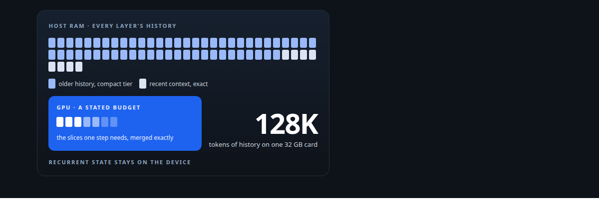
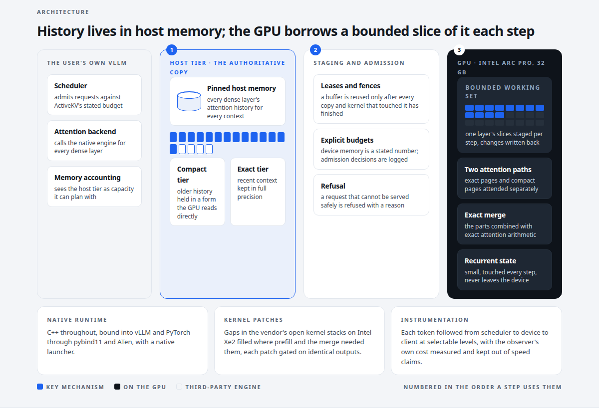
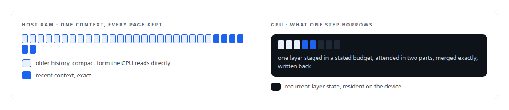
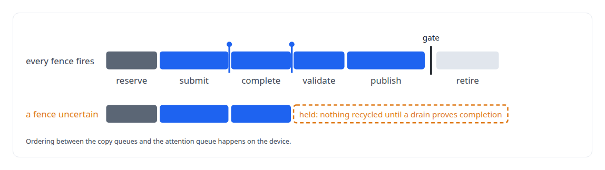
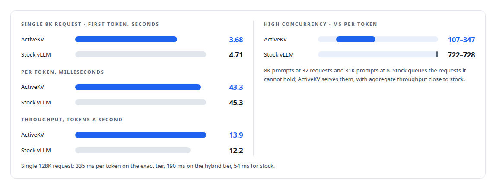

# ActiveKV

**An inference-memory layer for vLLM: the conversation's history in host RAM, the GPU as a bounded working set**

Canonical: https://coreyjames.ai/systems/activekv/  
Author: Corey James · Published: 2026-10-28 · Kind: system  
Technologies: [Bash](https://github.com/coreyjames-ai/portfolio/tree/main/technologies/bash) · [C++](https://github.com/coreyjames-ai/portfolio/tree/main/technologies/c-plus-plus) · [CUDA C++](https://github.com/coreyjames-ai/portfolio/tree/main/technologies/cuda-c-plus-plus) · [CUTLASS](https://github.com/coreyjames-ai/portfolio/tree/main/technologies/cutlass) · [Determinism and numerical reproducibility](https://github.com/coreyjames-ai/portfolio/tree/main/technologies/determinism-and-numerical-reproducibility) · [Docker](https://github.com/coreyjames-ai/portfolio/tree/main/technologies/docker) · [GPU memory management](https://github.com/coreyjames-ai/portfolio/tree/main/technologies/gpu-memory-management) · [GPU profiling and tracing](https://github.com/coreyjames-ai/portfolio/tree/main/technologies/gpu-profiling-and-tracing) · [Governed AI-assisted software engineering](https://github.com/coreyjames-ai/portfolio/tree/main/technologies/governed-ai-assisted-software-engineering) · [Hugging Face Hub](https://github.com/coreyjames-ai/portfolio/tree/main/technologies/hugging-face-hub) · [Intel Arc GPUs](https://github.com/coreyjames-ai/portfolio/tree/main/technologies/intel-arc-gpus) · [Intel oneAPI](https://github.com/coreyjames-ai/portfolio/tree/main/technologies/intel-oneapi) · [KV-cache engineering](https://github.com/coreyjames-ai/portfolio/tree/main/technologies/kv-cache-engineering) · [LD_PRELOAD symbol interposition](https://github.com/coreyjames-ai/portfolio/tree/main/technologies/ld-preload-symbol-interposition) · [Large-scale refactoring with parity proof](https://github.com/coreyjames-ai/portfolio/tree/main/technologies/large-scale-refactoring-with-parity-proof) · [Model families and types](https://github.com/coreyjames-ai/portfolio/tree/main/technologies/model-families-and-types) · [Model quantization](https://github.com/coreyjames-ai/portfolio/tree/main/technologies/model-quantization) · [NVIDIA Blackwell GPUs](https://github.com/coreyjames-ai/portfolio/tree/main/technologies/nvidia-blackwell-gpus) · [OpenAI-compatible API](https://github.com/coreyjames-ai/portfolio/tree/main/technologies/openai-compatible-api) · [Performance engineering and benchmarking](https://github.com/coreyjames-ai/portfolio/tree/main/technologies/performance-engineering-and-benchmarking) · [PyTorch](https://github.com/coreyjames-ai/portfolio/tree/main/technologies/pytorch) · [Python](https://github.com/coreyjames-ai/portfolio/tree/main/technologies/python) · [SYCL](https://github.com/coreyjames-ai/portfolio/tree/main/technologies/sycl) · [oneDNN](https://github.com/coreyjames-ai/portfolio/tree/main/technologies/onednn) · [pybind11](https://github.com/coreyjames-ai/portfolio/tree/main/technologies/pybind11) · [vLLM](https://github.com/coreyjames-ai/portfolio/tree/main/technologies/vllm)  
Skills: [Intel GPU and SYCL/oneAPI engineering](https://github.com/coreyjames-ai/portfolio/tree/main/skills/intel-gpu-and-sycl-oneapi-engineering) · [C++ and native ports with parity proof](https://github.com/coreyjames-ai/portfolio/tree/main/skills/c-and-native-ports-with-parity-proof) · [KV-cache offload for LLM inference](https://github.com/coreyjames-ai/portfolio/tree/main/skills/kv-cache-offload-for-llm-inference) · [GPU inference optimisation](https://github.com/coreyjames-ai/portfolio/tree/main/skills/gpu-inference-optimisation)  



## Result

| Figure | What it measures |
| --- | --- |
| **13 of 13** | exact cells bit-identical to fully resident attention at the port, 12 of 12 hybrid |
| **1 of 867** | former Python dispatch sites still in Python, kept by a cited framework contract |
| **12–22%** | lower time to first token than stock vLLM, single request, every context length |
| **20%** | faster cold 32K-token prefill from the Xe2 kernel patches |



## What was built

Every serving engine I have worked with assumes a model's working memory lives on the GPU. That assumption is why a 32 GB card decides how much context a model can hold. I decided to remove it. ActiveKV is an inference-memory layer I architected for vLLM: the conversation's attention history lives in pinned host RAM, and the GPU keeps a bounded, budgeted working set. On one Intel Arc Pro GPU, a 27-billion-parameter model serves 128,000-token histories. On a single 8,000-token request it beats stock vLLM on time to first token, inter-token latency and throughput. The runtime is C++ throughout, ported from a Python prototype without changing an output bit, and it is delivered as compiled binaries plus a patch to the user's own vLLM.

## The idea

Dense-attention history is written to host memory as the authoritative copy. The GPU holds the slices each decode step needs, staged across the bus under an explicit budget. Recurrent-layer state stays on the device, because it is small and it is touched every step. That one inversion lets a single workstation card serve long documents, whole codebases and agents that have been working for hours.


Two precision tiers serve that history: the exact tier, and a hybrid tier that keeps recent context exact and holds older history in a compact form the GPU reads directly; the two parts are combined with exact attention arithmetic, so long contexts decode at about half the per-token latency of the exact tier with no approximation in the merge.



## What I built

The host-authoritative KV tier is pinned host memory holding every layer's history, a per-layer staging working set on the GPU with a stated budget, and fence-safe asynchronous staging with an explicit lifecycle, so a buffer is never reused while a copy or a kernel still touches it.



The two precision tiers have separate contracts. The exact BF16 path is held to bit-identical output. The hybrid path is judged on bytes saved per token against GPU time added at the target context length. That gate is economic: a slower kernel that moves fewer bytes wins on a transfer-bound path. I had to overturn my own earlier per-tile rule to get there, which is the story in [Judge a representation by the bytes it stops moving](https://coreyjames.ai/stories/judge-a-representation-by-the-bytes-it-stops-moving).

Device memory budgets, admission and refusal are explicit, and nothing stalls.

The engine is native C++, bound into vLLM and PyTorch through pybind11 and ATen, with a native launcher. The release payload contains no Python of mine; the one remaining Python dispatch is justified line by line against the framework contract that requires it. See [Rewriting an engine extension without changing a token](https://coreyjames.ai/stories/rewriting-an-engine-extension-without-changing-a-token).

I patched the vendor's open kernel stacks on Intel Xe2 where they had gaps: GEMM tile selection for prefill, occupancy and a missing synchronisation in recurrent-layer prefill, and the attention statistic the exact cross-tier merge needs. Each patch was gated on identical outputs, and recurrent prefill halved per chunk. See [Bringing a serving stack up on new silicon](https://coreyjames.ai/stories/bringing-a-serving-stack-up-on-new-silicon).

Instrumentation follows each token from scheduler to device to client, at selectable levels, with its own overhead measured so that instrumented runs are never quoted as product speed. The day the profiler turned out to be causing the serialisation it reported is [The observer that changed the answer](https://coreyjames.ai/stories/the-observer-that-changed-the-answer).

The release process produces binaries and a patch with build receipts, keeps diagnostic builds separate, and runs every performance change as an A/B on a quiet host through an intake review that rejects gains tuned to the test fixture.

## Results

Measured on one Intel Arc Pro GPU serving a 4-bit-weight build of a 27-billion-parameter hybrid recurrent-attention open-weight model, quiet host, instrumentation off.



Histories from 32,000 to 128,000 tokens are served on the one card. At the longest single-request contexts stock vLLM still decodes faster per token, because every step pays to stage history across the bus. That is the trade ActiveKV makes for capacity, and the hybrid tier halves the cost. The release passed twelve of twelve on both routes.

## What it demonstrates

Deep integration into a third-party engine's scheduler, worker, attention backend and memory accounting. Lifecycle-safe asynchronous host-to-device staging. Exact attention merging across precision tiers. A lossy compression tier with its own kernels and quality contract. A full Python-to-C++ port under bitwise-parity gates. Kernel tuning on a new accelerator architecture. And the discipline to build instrumentation that does not change what it measures, and to retract the one finding where it did.

## Stories

[Context beyond VRAM](https://coreyjames.ai/stories/context-beyond-vram) · [Rewriting an engine extension without changing a token](https://coreyjames.ai/stories/rewriting-an-engine-extension-without-changing-a-token) · [Proving a rewrite is the same system](https://coreyjames.ai/stories/proving-a-rewrite-is-the-same-system) · [Judge a representation by the bytes it stops moving](https://coreyjames.ai/stories/judge-a-representation-by-the-bytes-it-stops-moving) · [The observer that changed the answer](https://coreyjames.ai/stories/the-observer-that-changed-the-answer) · [Bringing a serving stack up on new silicon](https://coreyjames.ai/stories/bringing-a-serving-stack-up-on-new-silicon) · [A 27B model on one 32 GB Intel card](https://coreyjames.ai/stories/a-27b-model-on-one-32gb-intel-card) · [Half the bytes, exactly merged](https://coreyjames.ai/stories/half-the-bytes-exactly-merged) · [Staging without a stall](https://coreyjames.ai/stories/staging-without-a-stall)

## Technologies

C++ · SYCL and oneAPI · vLLM internals · PyTorch XPU and ATen · pybind11 and the CPython C API · oneDNN · GPU memory management · KV-cache engineering · Intel Arc GPUs · Bitwise parity validation · Instrumented performance methodology

> Context length should be a host-memory budget, and it should stop being a hardware limit.

## What was verified

Each line is a claim the canonical page supports, with the figure as the page states it.

- KV-cache offload for LLM inference: attention history in host RAM with the GPU as a bounded working set, on one Intel Arc Pro GPU with 32 GB.
- C++ and native ports with parity proof: a Python runtime ported to C++ with 13 of 13 exact cells bit-identical and 1 of 867 dispatch sites left in Python under a cited contract.
- Inference serving architecture: 12-22% lower time to first token than stock vLLM on a single request at every context length.
- Intel GPU and SYCL/oneAPI engineering: kernel patches on Xe2 for 20% faster cold 32K-token prefill, each gated on identical outputs.
- vLLM internals: delivered as compiled binaries plus a patch to the user's own vLLM, with no Python of mine in the release payload.
- Observability and instrumentation: per-token tracing from scheduler to device to client at selectable levels, with its own overhead measured.

## Related

- [Context beyond VRAM](https://github.com/coreyjames-ai/activekv/tree/main/stories/context-beyond-vram) · https://coreyjames.ai/stories/context-beyond-vram/
- [Rewriting an engine extension without changing a token](https://github.com/coreyjames-ai/activekv/tree/main/stories/rewriting-an-engine-extension-without-changing-a-token) · https://coreyjames.ai/stories/rewriting-an-engine-extension-without-changing-a-token/
- [Proving a rewrite is the same system](https://github.com/coreyjames-ai/activekv/tree/main/stories/proving-a-rewrite-is-the-same-system) · https://coreyjames.ai/stories/proving-a-rewrite-is-the-same-system/
- [Judge a representation by the bytes it stops moving](https://github.com/coreyjames-ai/activekv/tree/main/stories/judge-a-representation-by-the-bytes-it-stops-moving) · https://coreyjames.ai/stories/judge-a-representation-by-the-bytes-it-stops-moving/
- [The observer that changed the answer](https://github.com/coreyjames-ai/activekv/tree/main/stories/the-observer-that-changed-the-answer) · https://coreyjames.ai/stories/the-observer-that-changed-the-answer/
- [Bringing a serving stack up on new silicon](https://github.com/coreyjames-ai/activekv/tree/main/stories/bringing-a-serving-stack-up-on-new-silicon) · https://coreyjames.ai/stories/bringing-a-serving-stack-up-on-new-silicon/
- [A 27B model on one 32 GB Intel card](https://github.com/coreyjames-ai/capabilities-model/tree/main/stories/a-27b-model-on-one-32gb-intel-card) · https://coreyjames.ai/stories/a-27b-model-on-one-32gb-intel-card/
- [Half the bytes, exactly merged](https://github.com/coreyjames-ai/activekv/tree/main/stories/half-the-bytes-exactly-merged) · https://coreyjames.ai/stories/half-the-bytes-exactly-merged/
- [Staging without a stall](https://github.com/coreyjames-ai/activekv/tree/main/stories/staging-without-a-stall) · https://coreyjames.ai/stories/staging-without-a-stall/

## Skills demonstrated

Decided at build time against every page in this system, strongest first; each links to the page that earns it.

- [KV-cache offload for LLM inference](https://github.com/coreyjames-ai/portfolio/tree/main/skills/kv-cache-offload-for-llm-inference) · [Context beyond VRAM](https://github.com/coreyjames-ai/activekv/tree/main/stories/context-beyond-vram)
- [Intel GPU and SYCL/oneAPI engineering](https://github.com/coreyjames-ai/portfolio/tree/main/skills/intel-gpu-and-sycl-oneapi-engineering) · [Bringing a serving stack up on new silicon](https://github.com/coreyjames-ai/activekv/tree/main/stories/bringing-a-serving-stack-up-on-new-silicon)
- [C++ and native ports with parity proof](https://github.com/coreyjames-ai/portfolio/tree/main/skills/c-and-native-ports-with-parity-proof) · [ActiveKV](https://github.com/coreyjames-ai/activekv)
- [GPU inference optimisation](https://github.com/coreyjames-ai/portfolio/tree/main/skills/gpu-inference-optimisation) · [Half the bytes, exactly merged](https://github.com/coreyjames-ai/activekv/tree/main/stories/half-the-bytes-exactly-merged)
- [inference serving architecture](https://github.com/coreyjames-ai/portfolio/tree/main/skills/inference-serving-architecture) · [ActiveKV](https://github.com/coreyjames-ai/activekv)
- [technical leadership of agent teams](https://github.com/coreyjames-ai/portfolio/tree/main/skills/technical-leadership-of-agent-teams) · [Rewriting an engine extension without changing a token](https://github.com/coreyjames-ai/activekv/tree/main/stories/rewriting-an-engine-extension-without-changing-a-token)
- [vLLM internals](https://github.com/coreyjames-ai/portfolio/tree/main/skills/vllm-internals) · [Context beyond VRAM](https://github.com/coreyjames-ai/activekv/tree/main/stories/context-beyond-vram)

## Engineering stories in ActiveKV (8)

| Story | Result | Figure |
| --- | --- | --- |
| [Rewriting an engine extension without changing a token](stories/rewriting-an-engine-extension-without-changing-a-token) | Porting a GPU serving layer from Python to native C++ with bit-identical output, and proving every remaining line of Python was required | 13 of 13 |
| [Proving a rewrite is the same system](stories/proving-a-rewrite-is-the-same-system) | Parity discipline for a GPU runtime, and the day I voided over a thousand passing trials | 12 of 12 |
| [Context beyond VRAM](stories/context-beyond-vram) | Making a 27-billion-parameter model hold more conversation than its GPU can, exactly, on one card | 27B |
| [Judge a representation by the bytes it stops moving](stories/judge-a-representation-by-the-bytes-it-stops-moving) | Rewriting an acceptance gate that kept rejecting good compression, and what it bought at 128K tokens | 0.7× |
| [The observer that changed the answer](stories/the-observer-that-changed-the-answer) | Discovering that my own profiler caused the serialisation it reported, and retracting a verdict I had already acted on | ≤ 0.21 |
| [Bringing a serving stack up on new silicon](stories/bringing-a-serving-stack-up-on-new-silicon) | Patching Intel's Xe2 kernel stack where it had gaps, with outputs that stayed identical | 48 |
| [Half the bytes, exactly merged](stories/half-the-bytes-exactly-merged) | The INT8 history format and the SYCL attention kernels that halve ActiveKV's bus traffic, and the log-sum-exp merge that keeps the result exact | 0.00267 |
| [Staging without a stall](stories/staging-without-a-stall) | The fence-safe lifecycle and the admission arithmetic that let ActiveKV stream history across the bus without ever reading a stale buffer | 12 of 12 |

Part of [Corey James's portfolio](https://github.com/coreyjames-ai/portfolio): research, technologies, skills and the other systems. Canonical site: https://coreyjames.ai/

## Citation

Corey James. "ActiveKV." coreyjames.ai, 2026. https://coreyjames.ai/systems/activekv/

```bibtex
@misc{coreyjames-activekv,
  author = {Corey James},
  title = {ActiveKV},
  year = {2026},
  howpublished = {\url{https://coreyjames.ai/systems/activekv/}},
  note = {GitHub copy: https://github.com/coreyjames-ai/activekv}
}
```

Part of [ActiveKV](https://github.com/coreyjames-ai/activekv) and [Corey James's portfolio](https://github.com/coreyjames-ai/portfolio) · site: https://coreyjames.ai/ · MCP server: https://coreyjames.ai/mcp · agent card: https://coreyjames.ai/.well-known/agent.json
