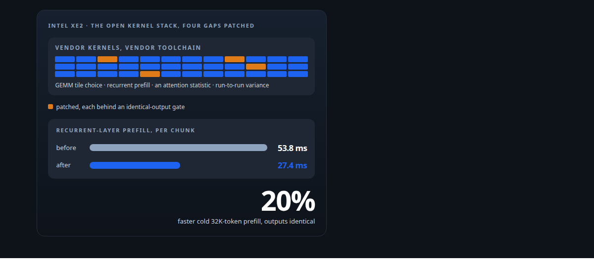
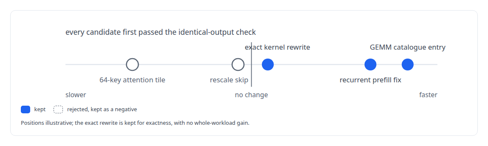
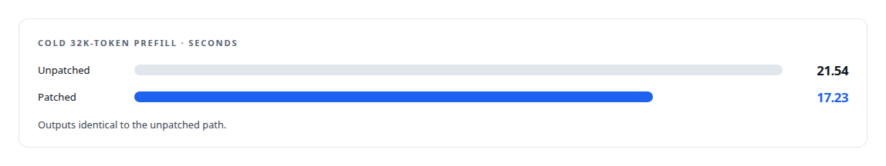

# Bringing a serving stack up on new silicon

**Patching Intel's Xe2 kernel stack where it had gaps, with outputs that stayed identical**

Canonical: https://coreyjames.ai/stories/bringing-a-serving-stack-up-on-new-silicon/  
Author: Corey James · Published: 2026-10-28 · Kind: story  
DOI: https://doi.org/10.5281/zenodo.23735116 (this page is a chapter of the system's report)  
Systems: [ActiveKV](https://github.com/coreyjames-ai/activekv)  
Technologies: [CUTLASS](https://github.com/coreyjames-ai/portfolio/tree/main/technologies/cutlass) · [GPU numerical kernel design](https://github.com/coreyjames-ai/portfolio/tree/main/technologies/gpu-numerical-kernel-design) · [Intel Arc GPUs](https://github.com/coreyjames-ai/portfolio/tree/main/technologies/intel-arc-gpus) · [Intel oneAPI](https://github.com/coreyjames-ai/portfolio/tree/main/technologies/intel-oneapi) · [SYCL](https://github.com/coreyjames-ai/portfolio/tree/main/technologies/sycl) · [oneDNN](https://github.com/coreyjames-ai/portfolio/tree/main/technologies/onednn)  
Skills: [Intel GPU and SYCL/oneAPI engineering](https://github.com/coreyjames-ai/portfolio/tree/main/skills/intel-gpu-and-sycl-oneapi-engineering) · [GPU inference optimisation](https://github.com/coreyjames-ai/portfolio/tree/main/skills/gpu-inference-optimisation) · [AI-assisted engineering methodology](https://github.com/coreyjames-ai/portfolio/tree/main/skills/ai-assisted-engineering-methodology) · [vLLM internals](https://github.com/coreyjames-ai/portfolio/tree/main/skills/vllm-internals)  



## Result

| Figure | What it measures |
| --- | --- |
| **48** | special-value combinations checked in one exact, flat rewrite |
| **2** | attention candidates rejected and kept as negatives |
| **5** | memory fences added for a synchronisation the original lacked |

## What was built

The Intel Arc Pro GPU is a new architecture, and the open kernel stacks that serve large models on it had gaps when I started: a GEMM path that chose the wrong tile for prefill, a recurrent-layer prefill with poor occupancy and a missing synchronisation, a missing attention statistic my memory layer needs, and run-to-run variance in some GEMM shapes. I patched the vendor's own sources inside the vendor's toolchain, with an identical-output gate on every change. Outputs stayed unchanged on the gated path.

## The challenge

Serving on brand-new hardware means working above a kernel stack that is still catching up with the silicon. The vendor's libraries were open, which made patching possible, and a patch to a GEMM library or an attention kernel that changes a single bit of output invalidates every parity result above it. I needed speed where the stack was slow, exactness where the stack was approximate, and a way to prove both for every change.

## Constraints

The vendor's sources and the vendor's toolchain, so the ABI matched what the serving engine loaded. Identical outputs against the unpatched path on the quiet benchmark host. Negative results kept. And honest attribution: these are patches and extensions to Intel's open stacks.

## My approach

One change, one patch, one gate. Each candidate was a self-contained patch with an identical-output check and a whole-workload measurement. I kept real systems improvements, fewer instructions, fewer allocations, exact arithmetic, even when the whole-workload metric was flat, because correctness and stability improvements are worth keeping on their own. I rejected speed-ups that changed outputs or won only on a narrow shape.



## What I built

A one-entry GEMM catalogue patch in oneDNN for the Xe2 prefill shape, which is where the prefill gain came from.

A recurrent-layer prefill fix: occupancy, output split, and memory fences for a synchronisation the original lacked.

The missing attention statistic, added to the paged attention path.

A validation determinism switch that pins the variable GEMM shapes for parity runs.

Post-port lowering patches for the 4-bit-weight model path, and scratch-slab and query/key reuse patches in the recurrent layer, which cut instructions and allocations.

## Difficult decisions

Rejecting attention candidates that did not earn their place, and keeping them as negatives.

Accepting a flat change. One kernel rewrite produced exact instruction-set arithmetic with no whole-workload gain.


## Results

On one Intel Arc Pro GPU serving a 4-bit-weight build of a 27-billion-parameter hybrid recurrent-attention open-weight model:



The patches are delivered with ActiveKV as patches to the vendor stacks.

## Technologies used

SYCL and DPC++ · oneDNN · CUTLASS and CuTe for SYCL · Intel's vLLM XPU kernels · Intel Arc GPUs · Bit-identical validation

## What this demonstrates

Low-level GPU engineering on hardware the ecosystem has not caught up with yet, with honest attribution to the vendor base I built on, and the discipline to keep every output bit where it was.

The kernel stacks are Intel's; the patches are mine.

> Exactness is a property I want in the product.

## What was verified

Each line is a claim the canonical page supports, with the figure as the page states it.

- Intel GPU and SYCL/oneAPI engineering: patched the vendor's open kernel stacks on Intel Xe2 hardware to cut cold 32K-token prefill from 21.54 s to 17.23 s with identical outputs.
- GPU kernel development: a recurrent-layer prefill fix for occupancy, output split and a missing synchronisation, with 5 memory fences added.
- Numerical reproducibility and bitwise validation: an exact kernel rewrite checked across 48 special-value combinations, kept for exactness with no whole-workload gain.
- Performance engineering discipline: one change, one patch, one gate, with 2 attention candidates rejected and kept as documented negatives.

## Related

- [Context beyond VRAM](https://github.com/coreyjames-ai/activekv/tree/main/stories/context-beyond-vram) · https://coreyjames.ai/stories/context-beyond-vram/
- [Judge a representation by the bytes it stops moving](https://github.com/coreyjames-ai/activekv/tree/main/stories/judge-a-representation-by-the-bytes-it-stops-moving) · https://coreyjames.ai/stories/judge-a-representation-by-the-bytes-it-stops-moving/
- [A 27B model on one 32 GB Intel card](https://github.com/coreyjames-ai/capabilities-model/tree/main/stories/a-27b-model-on-one-32gb-intel-card) · https://coreyjames.ai/stories/a-27b-model-on-one-32gb-intel-card/

## Citation

Corey James. "Bringing a serving stack up on new silicon." coreyjames.ai, 2026. https://coreyjames.ai/stories/bringing-a-serving-stack-up-on-new-silicon/ In: the ActiveKV technical report, doi:10.5281/zenodo.23735116.

```bibtex
@misc{coreyjames-bringing-a-serving-stack-up-on-new-silicon,
  author = {Corey James},
  title = {Bringing a serving stack up on new silicon},
  year = {2026},
  howpublished = {\url{https://coreyjames.ai/stories/bringing-a-serving-stack-up-on-new-silicon/}},
  note = {GitHub copy: https://github.com/coreyjames-ai/activekv/tree/main/stories/bringing-a-serving-stack-up-on-new-silicon},
  doi = {10.5281/zenodo.23735116}
}
```

Part of [ActiveKV](https://github.com/coreyjames-ai/activekv) and [Corey James's portfolio](https://github.com/coreyjames-ai/portfolio) · site: https://coreyjames.ai/ · MCP server: https://coreyjames.ai/mcp · agent card: https://coreyjames.ai/.well-known/agent.json
