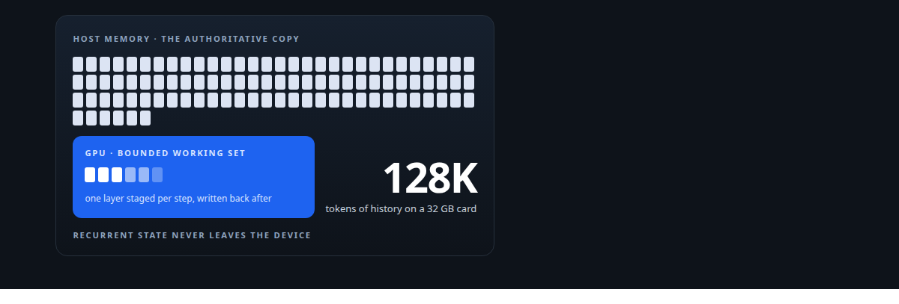
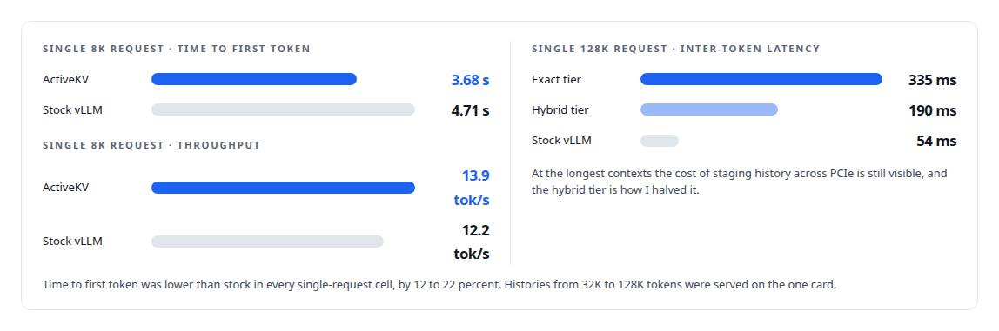

# Context beyond VRAM

**Making a 27-billion-parameter model hold more conversation than its GPU can, exactly, on one card**

Canonical: https://coreyjames.ai/stories/context-beyond-vram/  
Author: Corey James · Published: 2026-10-28 · Kind: story  
Systems: [ActiveKV](https://github.com/coreyjames-ai/activekv)  
Technologies: [C++](https://github.com/coreyjames-ai/portfolio/tree/main/technologies/c-plus-plus) · [CUTLASS](https://github.com/coreyjames-ai/portfolio/tree/main/technologies/cutlass) · [GPU memory management](https://github.com/coreyjames-ai/portfolio/tree/main/technologies/gpu-memory-management) · [Intel Arc GPUs](https://github.com/coreyjames-ai/portfolio/tree/main/technologies/intel-arc-gpus) · [Intel oneAPI](https://github.com/coreyjames-ai/portfolio/tree/main/technologies/intel-oneapi) · [KV-cache engineering](https://github.com/coreyjames-ai/portfolio/tree/main/technologies/kv-cache-engineering) · [Model families and types](https://github.com/coreyjames-ai/portfolio/tree/main/technologies/model-families-and-types) · [OpenAI-compatible API](https://github.com/coreyjames-ai/portfolio/tree/main/technologies/openai-compatible-api) · [PyTorch](https://github.com/coreyjames-ai/portfolio/tree/main/technologies/pytorch) · [SYCL](https://github.com/coreyjames-ai/portfolio/tree/main/technologies/sycl) · [vLLM](https://github.com/coreyjames-ai/portfolio/tree/main/technologies/vllm)  
Skills: [KV-cache offload for LLM inference](https://github.com/coreyjames-ai/portfolio/tree/main/skills/kv-cache-offload-for-llm-inference) · [Intel GPU and SYCL/oneAPI engineering](https://github.com/coreyjames-ai/portfolio/tree/main/skills/intel-gpu-and-sycl-oneapi-engineering) · [GPU inference optimisation](https://github.com/coreyjames-ai/portfolio/tree/main/skills/gpu-inference-optimisation) · [inference serving architecture](https://github.com/coreyjames-ai/portfolio/tree/main/skills/inference-serving-architecture)  



## Result

| Figure | What it measures |
| --- | --- |
| **27B** | parameters, a hybrid recurrent-attention model |
| **32 GB** | one Intel Arc Pro GPU, no second card |
| **13 of 13** | exact cells bit-identical to fully resident attention |

## What was built

A language model remembers a conversation through its key-value cache, and every serving engine I know keeps that whole cache on the GPU. For a long document, a codebase or an agent that has been working for hours, the cache grows with every token until it is the largest thing on the card after the weights. At that point the card's memory decides how much context the model can hold. I decided the history should leave the card and the request should keep running. ActiveKV is the result: a 27-billion-parameter model serving 128,000-token histories on one 32 GB Intel Arc Pro GPU, with an exact mode that is bit-identical to fully resident attention.

## The challenge

The offload vLLM already had was a prefix cache. It could reuse a prompt it had seen before, and it could not keep an in-flight request going once that request's context outgrew the GPU. The usual answers are bigger cards, more cards or less context. I wanted the option that did not exist.

## Constraints

One workstation card, an Intel Arc Pro GPU with 32 GB, on Intel's XPU stack, with some kernels for the new Xe2 architecture still maturing. A hybrid model that mixes recurrent layers with full attention, so recurrent state and attention cache have different lifetimes. PCIe as the binding cost, since every byte staged in or written back crosses the bus. A patch to the user's own vLLM as the deliverable, so my layer had to live inside vLLM's scheduler, attention backend and memory accounting. And exactness: the exact mode had to match fully resident attention bit for bit wherever the reference is itself deterministic, with no safety check removed to get there.

## My approach

I inverted the ownership of memory. Pinned host memory became the authoritative copy of each context's attention history. The GPU became a bounded working set with a stated budget: a staging region that holds what the current step needs. Only attention KV moves across the bus; recurrent-layer state never leaves the device.

I split the work into two programmes with two gates. Correctness first: an exact mode held to bit-identical output against the fully resident path. Speed second, and it was not allowed to start until correctness had closed. That cost time and it gave the performance work a fixed reference.


## What I built

A fence-safe staging pipeline. Each decode step stages a layer's history in, appends the new KV, attends, and writes changes back. A staging buffer is released only after every copy and kernel that touched it has finished.

Two precision tiers with separate contracts. The exact BF16 path came first. The hybrid tier followed: recent context stays exact, older history is held in a compact form the GPU reads directly, and the two are merged with exact attention arithmetic. The hybrid tier is judged on PCIe bytes saved against GPU time added.

Explicit budgets and refusal. Device budgets are stated, admission decisions are logged, and a request that cannot be served safely is refused or shrunk.

A checkpointed context lifecycle, so a long context can be suspended and resumed without recomputation.

A native C++ runtime throughout, with no Python of mine in the release payload. The port is its own story, [Rewriting an engine extension without changing a token](https://coreyjames.ai/stories/rewriting-an-engine-extension-without-changing-a-token).

Instrumentation that follows each token from scheduler to device to client, with its own overhead measured and kept out of speed claims.

## Difficult decisions

Bit-identical or nothing. Batched reference output from the stock engine varies slightly between its own runs. I ran every reference twice and demanded bitwise equality only where the reference agreed with itself, and judged within the reference's own spread everywhere else. The port passed thirteen of thirteen exact cells and twelve of twelve hybrid cells.

Spending reclaimed memory on purpose. Moving history off the card frees GPU memory. One change deliberately spent 8 GB of it to halve long-context latency under concurrency.


Judging kernels by bytes. An early rejection of a slower kernel was reversed when I rewrote the acceptance gate around end-to-end bytes moved at the target context size. On a transfer-bound path, a slower kernel that moves fewer bytes wins. See [Judge a representation by the bytes it stops moving](https://coreyjames.ai/stories/judge-a-representation-by-the-bytes-it-stops-moving).

## Results

On one Intel Arc Pro GPU serving a 4-bit-weight build of a 27-billion-parameter hybrid recurrent-attention open-weight model, quiet host, instrumentation off:



## Technologies used

C++ · SYCL and oneAPI · vLLM internals · PyTorch XPU extensions · Intel Arc GPUs · GPU memory management · KV-cache engineering · Bitwise validation · Instrumented performance methodology

## What this demonstrates

I can take a hard constraint in a third-party system, redesign the memory model underneath it, and deliver the result as a patch that survives parity testing against the original. I separate correctness from performance and gate them differently. And I state where a design wins and where it does not, with the fixture beside each number.

vLLM, PyTorch and Intel's kernel libraries are third-party; ActiveKV is the layer and tooling on top.

> Memory saved is only valuable if you decide what to buy with it.

## What was verified

Each line is a claim the canonical page supports, with the figure as the page states it.

- KV-cache offload for LLM inference: pinned host memory as the authoritative copy of attention history and the GPU as a bounded working set, serving 128K-token histories for a 27B hybrid recurrent-attention model on one 32 GB card.
- Numerical reproducibility and bitwise validation: an exact tier accepted only when 13 of 13 cells matched fully resident attention bit for bit, each reference run twice and held to bitwise equality only where it agreed with itself.
- vLLM internals: an offload layer built into vLLM's scheduler, attention backend and memory accounting and delivered as a patch, serving histories from 32K to 128K tokens on one card, with correctness closed before speed work began.
- Intel GPU and SYCL/oneAPI engineering: a fence-safe staging pipeline in a native C++ runtime on an Intel Arc Pro GPU, each staging buffer released only after every copy and kernel that touched it had finished.
- Latency engineering under concurrency: inter-token latency at 31K-token prompts with four concurrent requests cut from 274 ms to 141 ms by spending 8 GB of reclaimed GPU memory.
- GPU inference optimisation: time to first token 12 to 22 percent below stock vLLM in every single-request cell, and a hybrid precision tier that cut 128K-token inter-token latency from 335 ms to 190 ms.

## Related

- [Rewriting an engine extension without changing a token](https://github.com/coreyjames-ai/activekv/tree/main/stories/rewriting-an-engine-extension-without-changing-a-token) · https://coreyjames.ai/stories/rewriting-an-engine-extension-without-changing-a-token/
- [Proving a rewrite is the same system](https://github.com/coreyjames-ai/activekv/tree/main/stories/proving-a-rewrite-is-the-same-system) · https://coreyjames.ai/stories/proving-a-rewrite-is-the-same-system/
- [Judge a representation by the bytes it stops moving](https://github.com/coreyjames-ai/activekv/tree/main/stories/judge-a-representation-by-the-bytes-it-stops-moving) · https://coreyjames.ai/stories/judge-a-representation-by-the-bytes-it-stops-moving/
- [The observer that changed the answer](https://github.com/coreyjames-ai/activekv/tree/main/stories/the-observer-that-changed-the-answer) · https://coreyjames.ai/stories/the-observer-that-changed-the-answer/
- [A 27B model on one 32 GB Intel card](https://github.com/coreyjames-ai/capabilities-model/tree/main/stories/a-27b-model-on-one-32gb-intel-card) · https://coreyjames.ai/stories/a-27b-model-on-one-32gb-intel-card/

## Citation

Corey James. "Context beyond VRAM." coreyjames.ai, 2026. https://coreyjames.ai/stories/context-beyond-vram/

```bibtex
@misc{coreyjames-context-beyond-vram,
  author = {Corey James},
  title = {Context beyond VRAM},
  year = {2026},
  howpublished = {\url{https://coreyjames.ai/stories/context-beyond-vram/}},
  note = {GitHub copy: https://github.com/coreyjames-ai/activekv/tree/main/stories/context-beyond-vram}
}
```

Part of [ActiveKV](https://github.com/coreyjames-ai/activekv) and [Corey James's portfolio](https://github.com/coreyjames-ai/portfolio) · site: https://coreyjames.ai/ · MCP server: https://coreyjames.ai/mcp · agent card: https://coreyjames.ai/.well-known/agent.json
