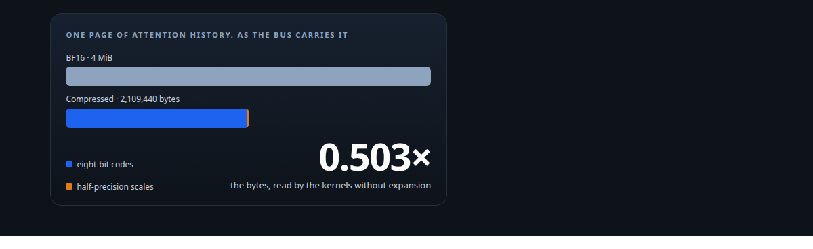
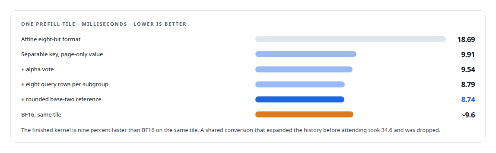
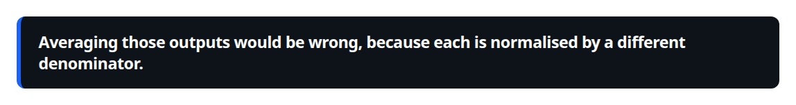
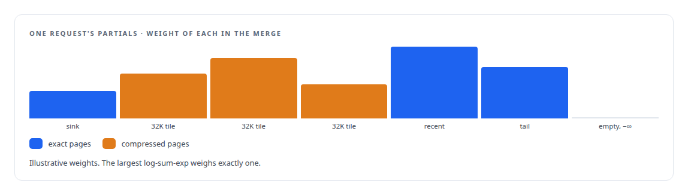
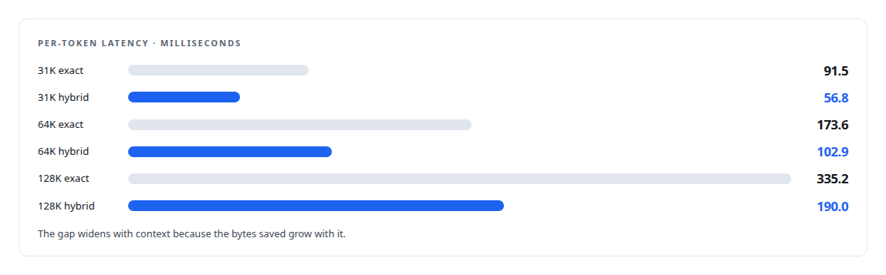

# Half the bytes, exactly merged

**The INT8 history format and the SYCL attention kernels that halve ActiveKV's bus traffic, and the log-sum-exp merge that keeps the result exact**

Canonical: https://coreyjames.ai/stories/half-the-bytes-exactly-merged/  
Author: Corey James · Published: 2026-10-28 · Kind: story  
Systems: [ActiveKV](https://github.com/coreyjames-ai/activekv)  
Technologies: [GPU numerical kernel design](https://github.com/coreyjames-ai/portfolio/tree/main/technologies/gpu-numerical-kernel-design) · [Intel Arc GPUs](https://github.com/coreyjames-ai/portfolio/tree/main/technologies/intel-arc-gpus) · [KV-cache engineering](https://github.com/coreyjames-ai/portfolio/tree/main/technologies/kv-cache-engineering) · [Model quantization](https://github.com/coreyjames-ai/portfolio/tree/main/technologies/model-quantization) · [SYCL](https://github.com/coreyjames-ai/portfolio/tree/main/technologies/sycl)  
Skills: [KV-cache offload for LLM inference](https://github.com/coreyjames-ai/portfolio/tree/main/skills/kv-cache-offload-for-llm-inference) · [GPU inference optimisation](https://github.com/coreyjames-ai/portfolio/tree/main/skills/gpu-inference-optimisation) · [inference serving architecture](https://github.com/coreyjames-ai/portfolio/tree/main/skills/inference-serving-architecture) · [Intel GPU and SYCL/oneAPI engineering](https://github.com/coreyjames-ai/portfolio/tree/main/skills/intel-gpu-and-sycl-oneapi-engineering)  



## Result

| Figure | What it measures |
| --- | --- |
| **0.00267** | worst merged own-format error of the selected format |
| **12 of 12** | bitwise cells the hybrid route passes against its own reference |
| **26%** | faster decode of one query row over a 32-page compressed tile than BF16 |
| **31%** | faster again when one launch serves two requests |

## What was built

Once a model's attention history lives in host memory, decode speed is bus arithmetic. The model ActiveKV serves carries 64 KiB of key-value history per token across its sixteen dense layers, and the exact path re-reads all of it for every generated token: 2.1 GB at 32K tokens, 8.4 GB at 128K, across a copy engine that moves about 26 GB per second. A calibrated model of that arithmetic matched measured latency within a few percent at every context length. So the way to make long contexts faster was to move fewer bytes without changing the answer. That took a compressed history format, attention kernels that read it directly, and a merge that combines compressed and exact attention with no approximation.

## The format

One page holds 1,024 tokens of one layer: four key-value heads by 256 channels. The compressed form stores eight-bit codes and a small amount of half-precision metadata.

Keys use a separable scale. For each page and head, a per-channel scale absorbs half of each channel's dynamic range on a log scale: the root-mean-square of the channel over the page's tokens, square-rooted, normalised so the channel scales multiply to one. Keys are divided by that, then a per-token scale takes the remaining magnitude, and the code is the round-half-to-even quotient clipped to a symmetric range. The channel factor does not depend on the token, so in the query-key product it folds into the query once per page: the kernel quantises the scaled query to eight bits with one row scale, runs a signed integer dot product on the Xe2 matrix units, and applies the per-token scalar afterwards. Splitting the dynamic range half into the channel and half into the token keeps both the outlier channels and the per-token magnitude inside eight bits.

Values use a page-only scale, one per channel per page. The probability-value product can then accumulate on raw signed codes and multiply by the channel scale once. When attention crosses into the next page the accumulator is rescaled by the ratio of old to new scale, separately from the ordinary softmax correction, and the last page's scale restores physical units before normalisation. Value scales never touch the scores, the running maximum, the denominator or the log-sum-exp, so the softmax statistics are bit-identical to the uncompressed arithmetic on the same codes.

The format is lossy, so it is judged against its own higher-precision reference and never bitwise against BF16. The gate is a merged own-format error of at most 0.005 over 48 real samples and a 64K-token synthetic case. The earliest eight-bit screens, independent key-only, value-only and paired, all failed their loss limits. The format work is what made eight-bit history acceptable.

## The kernels

All compressed-tier operators derive from the vendor's SYCL flash-attention sources and are registered as separate operations so routing is explicit. The prefill mainloop, per 32-key tile and per subgroup of eight query rows, quantises the scaled query once per page and caches eight integer fragments in registers, runs integer query-key on the matrix units, scales the scores, runs an online softmax with probabilities and denominator in single precision, and runs half-precision probability-value on raw codes into a single-precision accumulator. Native review required each candidate to use 256 registers, zero spills, zero shared local memory, and matrix-unit site counts matching the design.

Two refinements came from watching the softmax. Late in a long context the running maximum rarely moves, so the rescale of the accumulator is almost always a multiply by exactly one. A convergent vote across the eight rows skips that multiply only when every row's factor is exactly one, which is the identity in IEEE arithmetic and therefore exact. And handling scores in base two with an integer running reference makes every rescale an exact power of two, an exponent shift, at the cost of one rounding instruction; the final log-sum-exp is reconstructed from the integer reference and the denominator. A two-owner decode kernel serves two requests whose next compressed tiles have the same page count in one launch, with separate accumulators and no cross-owner softmax.

The lineage ran from an affine eight-bit format far slower than BF16, through the discovery that integer query-key pays while integer probability-value costs more than it saves, to the separable format and the two refinements above. Also rejected along the way: centred keys, a persistent integer query cache, shared-memory query caching, and a 64-key tile.



## The merge

One request's attention is split across 32K-token tiles and across precisions: exact pages for the sink, the recent window and the tail, compressed pages for the rest. Each partial attention call returns a normalised output and a log-sum-exp over its own keys.



The merge takes the maximum of the partial log-sum-exps, weights each partial by the exponential of its log-sum-exp minus that maximum, combines the outputs by those weights, and reconstructs the total log-sum-exp. That is algebraically identical to softmax over the union of the keys, and subtracting the maximum keeps every exponent at or below zero so nothing overflows.



The kernel runs one work-group per token and head and one work-item per channel, all in single precision, folding a running accumulator with any number of partials. A partial with a log-sum-exp of negative infinity is an empty partial, for instance an unwritten row, and is skipped, so its possibly undefined output is never read. The vendor's paged-decode attention did not return a log-sum-exp at all; a patch adds one and initialises it to negative infinity, so a row no kernel wrote is a well-defined empty partial rather than garbage. Tiles merge in ascending order and the tail tile writes the final output in the model's dtype.

The merge introduces no approximation. Two things can change bits relative to a single resident call: single-precision summation order, and the lossy history representation in the hybrid tier, which belongs to the format and not to the merge. For the exact path with whole-layer staging there is no split and the output is bitwise identical to resident attention.

## Results

Single request, one Intel Arc Pro GPU, a 4-bit-weight build of a 27-billion-parameter hybrid recurrent-attention open-weight model:



## What this demonstrates

Numerical format design from the physics up, kernel engineering on a new accelerator's matrix units with exactness arguments for every shortcut, and the mathematics to combine partial attention across precisions without approximation. The bus arithmetic in the first paragraph is the whole reason the format exists.

> Averaging those outputs would be wrong, because each is normalised by a different denominator.

## What was verified

Each line is a claim the canonical page supports, with the figure as the page states it.

- LLM quantization (INT8 KV cache): a compressed history format with eight-bit codes and separable key scales, worst merged own-format error 0.00267 against a 0.005 gate.
- SYCL kernel development on Intel Xe2: integer query-key attention on the matrix units, from 18.69 to 8.74 ms per prefill tile, nine percent faster than BF16.
- Exact attention merging: partial attention across tiles and precisions combined through log-sum-exp weights with no approximation, 12 of 12 bitwise cells on the hybrid route.
- KV-cache offload for LLM inference: per-token latency at 128K tokens cut from 335.2 ms on the exact tier to 190.0 ms on the hybrid tier.
- GPU inference optimisation: one decode launch serving two requests 31% faster than two single calls, and one-row compressed decode 26% faster than BF16.

## Related

- [Context beyond VRAM](https://github.com/coreyjames-ai/activekv/tree/main/stories/context-beyond-vram) · https://coreyjames.ai/stories/context-beyond-vram/
- [Judge a representation by the bytes it stops moving](https://github.com/coreyjames-ai/activekv/tree/main/stories/judge-a-representation-by-the-bytes-it-stops-moving) · https://coreyjames.ai/stories/judge-a-representation-by-the-bytes-it-stops-moving/
- [Bringing a serving stack up on new silicon](https://github.com/coreyjames-ai/activekv/tree/main/stories/bringing-a-serving-stack-up-on-new-silicon) · https://coreyjames.ai/stories/bringing-a-serving-stack-up-on-new-silicon/

## Citation

Corey James. "Half the bytes, exactly merged." coreyjames.ai, 2026. https://coreyjames.ai/stories/half-the-bytes-exactly-merged/

```bibtex
@misc{coreyjames-half-the-bytes-exactly-merged,
  author = {Corey James},
  title = {Half the bytes, exactly merged},
  year = {2026},
  howpublished = {\url{https://coreyjames.ai/stories/half-the-bytes-exactly-merged/}},
  note = {GitHub copy: https://github.com/coreyjames-ai/activekv/tree/main/stories/half-the-bytes-exactly-merged}
}
```

Part of [ActiveKV](https://github.com/coreyjames-ai/activekv) and [Corey James's portfolio](https://github.com/coreyjames-ai/portfolio) · site: https://coreyjames.ai/ · MCP server: https://coreyjames.ai/mcp · agent card: https://coreyjames.ai/.well-known/agent.json
