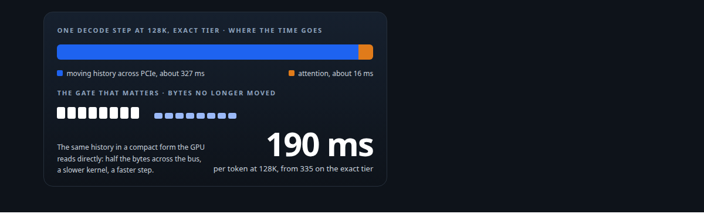
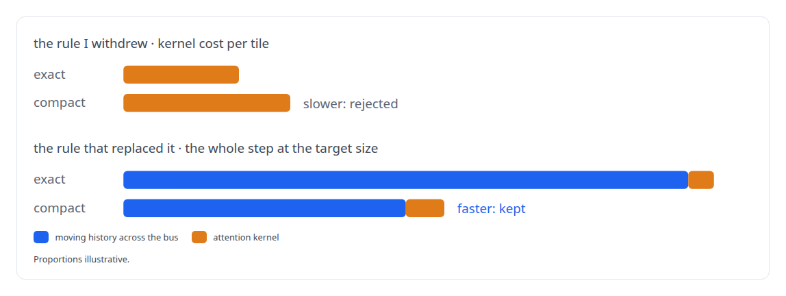
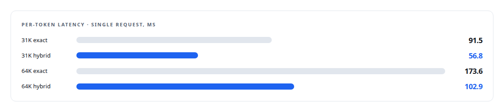

# Judge a representation by the bytes it stops moving

**Rewriting an acceptance gate that kept rejecting good compression, and what it bought at 128K tokens**

Canonical: https://coreyjames.ai/stories/judge-a-representation-by-the-bytes-it-stops-moving/  
Author: Corey James · Published: 2026-10-28 · Kind: story  
DOI: https://doi.org/10.5281/zenodo.23735116 (this page is a chapter of the system's report)  
Systems: [ActiveKV](https://github.com/coreyjames-ai/activekv)  
Technologies: [Intel Arc GPUs](https://github.com/coreyjames-ai/portfolio/tree/main/technologies/intel-arc-gpus) · [KV-cache engineering](https://github.com/coreyjames-ai/portfolio/tree/main/technologies/kv-cache-engineering) · [Model quantization](https://github.com/coreyjames-ai/portfolio/tree/main/technologies/model-quantization) · [Performance engineering and benchmarking](https://github.com/coreyjames-ai/portfolio/tree/main/technologies/performance-engineering-and-benchmarking) · [SYCL](https://github.com/coreyjames-ai/portfolio/tree/main/technologies/sycl) · [vLLM](https://github.com/coreyjames-ai/portfolio/tree/main/technologies/vllm)  
Skills: [GPU inference optimisation](https://github.com/coreyjames-ai/portfolio/tree/main/skills/gpu-inference-optimisation) · [KV-cache offload for LLM inference](https://github.com/coreyjames-ai/portfolio/tree/main/skills/kv-cache-offload-for-llm-inference) · [vLLM internals](https://github.com/coreyjames-ai/portfolio/tree/main/skills/vllm-internals) · [inference serving architecture](https://github.com/coreyjames-ai/portfolio/tree/main/skills/inference-serving-architecture)  



## Result

| Figure | What it measures |
| --- | --- |
| **0.7×** | the per-tile speed rule I had set, withdrawn after a false rejection |
| **12 of 12** | bitwise cells for the hybrid route against its own reference |
| **3 of 3** | context sizes measured where the hybrid tier decoded faster |

## What was built

Once a model's history lives in host memory, every decode step is bound by how many bytes cross the bus, and the attention kernel's speed is a rounding error. My acceptance gate for compressed history formats did not know that. It measured kernel speed per tile and kept rejecting candidates that would have won. I rewrote the gate around end-to-end economics at the target context size: bytes saved per token against GPU time added.

## The challenge

ActiveKV stages a context's attention history across PCIe on each step. At long contexts the copy dominates. A planning analysis for the exact tier put the transfer at many times the cost of the attention itself at 128K. A compressed format that halves the bytes should nearly halve the step. Its kernels are slower per tile than the exact ones, and a gate that compared kernel speed saw only the slowdown.

## Constraints

A lossy tier needs a quality contract of its own; earlier 8-bit screens had failed their loss limits. The compressed and exact parts of a history had to combine without approximation. And the same single card, one Intel Arc Pro GPU, with no second GPU to hide the transfer behind.

## My approach

Replace the per-tile rule with a whole-step economic one. For a candidate representation at the target context size: how many bytes does it stop moving per token, what does that save in transfer time, and how much GPU time do its kernels add? Accept if the net is positive at the sizes that matter.


## What I built

A compressed history representation and a hybrid serving mode, each with its own quality contract and its own reference.

The economic gate itself, with a transfer model derived from measured bus behaviour on the card, so candidates are judged on bytes saved per token at each target size.

## Difficult decisions

Overturning a rule I had set. The earlier rule, a fixed ceiling on a candidate's cost per tile against the exact tier, was mine. At 128K it produced a false rejection. I withdrew it and wrote the replacement with the physics beside it.



Keeping the quality bar. The economic gate made it easier to accept a compressed format. It did not touch the loss limit.

## Results

Single request, one Intel Arc Pro GPU, a 4-bit-weight build of a 27-billion-parameter hybrid recurrent-attention open-weight model:



Stock vLLM remains faster per token at these single-request contexts; that comparison is on the [ActiveKV page](https://coreyjames.ai/systems/activekv).

## Technologies used

SYCL kernels · Weight and activation quantisation · PCIe transfer modelling · vLLM · Intel Arc GPUs · KV-cache engineering

## What this demonstrates

First-principles systems economics over local optimisation. I will overturn my own rule when the physics says it is wrong, and I keep the quality bar in place while I do it.

> A format that loses at 8K and wins at 128K is a format for long contexts, and the gate should say so.

## What was verified

Each line is a claim the canonical page supports, with the figure as the page states it.

- KV-cache offload for LLM inference: an acceptance gate rewritten from per-tile kernel cost to whole-step economics, bytes saved per token against GPU time added.
- Performance modelling: a transfer model built from measured bus behaviour on the card, judging each candidate representation at its target context size.
- LLM quantization (INT8 KV cache): a compressed history tier that passed 12 of 12 bitwise cells against its own reference and decoded faster at 3 of 3 context sizes.
- Engineering judgment: withdrew my own 0.7x per-tile speed rule after it produced a false rejection at 128K tokens.

## Related

- [Context beyond VRAM](https://github.com/coreyjames-ai/activekv/tree/main/stories/context-beyond-vram) · https://coreyjames.ai/stories/context-beyond-vram/
- [Bringing a serving stack up on new silicon](https://github.com/coreyjames-ai/activekv/tree/main/stories/bringing-a-serving-stack-up-on-new-silicon) · https://coreyjames.ai/stories/bringing-a-serving-stack-up-on-new-silicon/

## Citation

Corey James. "Judge a representation by the bytes it stops moving." coreyjames.ai, 2026. https://coreyjames.ai/stories/judge-a-representation-by-the-bytes-it-stops-moving/ In: the ActiveKV technical report, doi:10.5281/zenodo.23735116.

```bibtex
@misc{coreyjames-judge-a-representation-by-the-bytes-it-stops-moving,
  author = {Corey James},
  title = {Judge a representation by the bytes it stops moving},
  year = {2026},
  howpublished = {\url{https://coreyjames.ai/stories/judge-a-representation-by-the-bytes-it-stops-moving/}},
  note = {GitHub copy: https://github.com/coreyjames-ai/activekv/tree/main/stories/judge-a-representation-by-the-bytes-it-stops-moving},
  doi = {10.5281/zenodo.23735116}
}
```

Part of [ActiveKV](https://github.com/coreyjames-ai/activekv) and [Corey James's portfolio](https://github.com/coreyjames-ai/portfolio) · site: https://coreyjames.ai/ · MCP server: https://coreyjames.ai/mcp · agent card: https://coreyjames.ai/.well-known/agent.json
