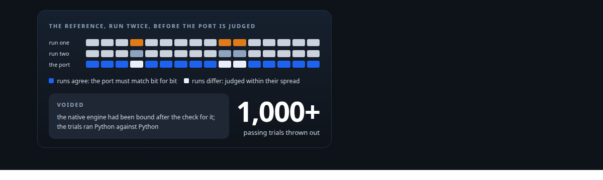
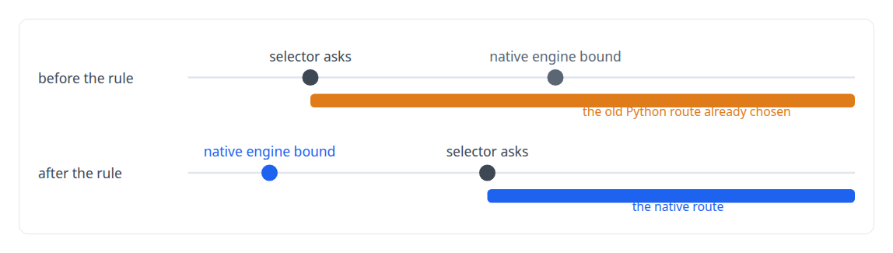
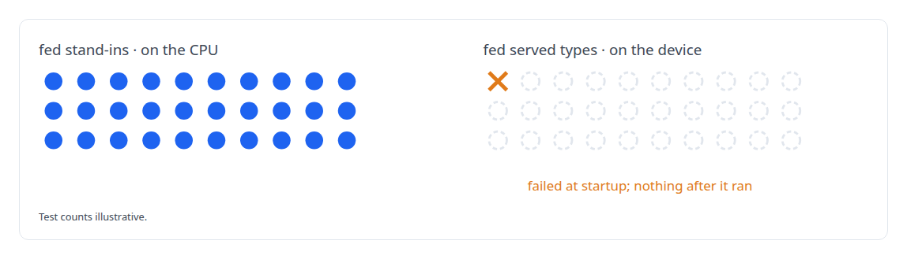

# Proving a rewrite is the same system

**Parity discipline for a GPU runtime, and the day I voided over a thousand passing trials**

Canonical: https://coreyjames.ai/stories/proving-a-rewrite-is-the-same-system/  
Author: Corey James · Published: 2026-10-28 · Kind: story  
Systems: [ActiveKV](https://github.com/coreyjames-ai/activekv)  
Technologies: [C++](https://github.com/coreyjames-ai/portfolio/tree/main/technologies/c-plus-plus) · [Determinism and numerical reproducibility](https://github.com/coreyjames-ai/portfolio/tree/main/technologies/determinism-and-numerical-reproducibility) · [Evidence-gated acceptance](https://github.com/coreyjames-ai/portfolio/tree/main/technologies/evidence-gated-acceptance) · [Independent verification and adversarial review](https://github.com/coreyjames-ai/portfolio/tree/main/technologies/independent-verification-and-adversarial-review) · [Large-scale refactoring with parity proof](https://github.com/coreyjames-ai/portfolio/tree/main/technologies/large-scale-refactoring-with-parity-proof) · [PyTorch](https://github.com/coreyjames-ai/portfolio/tree/main/technologies/pytorch) · [Python](https://github.com/coreyjames-ai/portfolio/tree/main/technologies/python) · [oneDNN](https://github.com/coreyjames-ai/portfolio/tree/main/technologies/onednn) · [pybind11](https://github.com/coreyjames-ai/portfolio/tree/main/technologies/pybind11) · [vLLM](https://github.com/coreyjames-ai/portfolio/tree/main/technologies/vllm)  
Skills: [C++ and native ports with parity proof](https://github.com/coreyjames-ai/portfolio/tree/main/skills/c-and-native-ports-with-parity-proof) · [evidence-gated acceptance](https://github.com/coreyjames-ai/portfolio/tree/main/skills/evidence-gated-acceptance)  



## Result

| Figure | What it measures |
| --- | --- |
| **12 of 12** | bitwise on both routes at the release |
| **100+** | lane notes voided and the count rebuilt from proofs |
| **3** | proofs before any lane may call a route native |

## What was built

A rewrite is finished when you can prove it behaves like the original. For a GPU serving runtime that means proving it on the real device, under concurrency, cancellation and shutdown, against a baseline that is not even bit-stable with itself in batched mode. Partway through the ActiveKV port I discovered that a long run of passing trials had been testing Python against Python, and the rule that came out of it now sits in the definition of done.

## The challenge

Three distinct problems hide inside "does the rewrite match". The baseline is not deterministic: stock vLLM's batched output varies between its own runs, so a naive bitwise gate would fail the original against itself. A test can pass without testing the served path: CPU differential suites fed with stand-in objects can be green while the real server, which passes different object types, fails at startup. And the native code has to be the code that runs.

## Constraints

Some references are non-deterministic, and loosening the gate everywhere to accommodate them would hide real divergence. Native safety checks could not be removed to make outputs line up. And with agents working in parallel lanes, each lane's claim of success had to be independently provable or it was worth nothing.

## My approach

Bitwise only where the reference is bitwise with itself. Run the reference twice first. Where the two runs agree, demand bitwise equality from the port. Where they differ, judge the port within the reference's own spread. Each mode is compared against its own reference.


Parity never removes a guard. When the native engine refuses something Python allowed, first prove which check fired and why. If the refusal is correct, the Python behaviour was the bug.

"Switched" means proven on the real startup path. A claim that a native route is in use requires the binding site, every call-site condition, and the run-log ordering that shows the binding happened before the decision.



## What I built

Per-lane differential suites fed with served object types, the same geometry, cache-manager and wire objects the real server passes.

Device proof runs that exercise cancellation, refusal and shutdown and keep the evidence, and process-map and stack captures showing that no product Python frames execute on the native route.

A switch-brief rule that no lane note may claim a route is native without the three proofs above, and a reachability count that treats a dispatch site as native only with a bind-order proof attached.

## Difficult decisions

Voiding the passing trials. The CPU suites had passed. They had been testing Python stand-ins instead of the real server's objects, and a device proof run failed at startup. The trials were declared void and the suites were rebuilt around served types.



Classifying dozens of refusals one by one. The native engine refused cases the Python engine had accepted. Each was traced to the guard that fired. None of the guards was relaxed; the cases where Python had been wrong became documented safe divergences.

Re-folding the count instead of patching it. When the bind-order defect surfaced, the lane notes resting on the false claim were voided and the count rebuilt from proofs.

## Results

Port parity was thirteen of thirteen exact cells and twelve of twelve hybrid cells, bitwise, and proof that the native route runs is a required criterion in the definition of done.

## Technologies used

C++ · Python · vLLM · PyTorch XPU · Bitwise comparison harnesses · Sampling profilers for process evidence · pybind11

## What this demonstrates

I am rigorous about what a test proves, and I check that the thing a suite ran is the thing that runs. When the process fails at program scale, I fix the process.

> A green suite is a claim about the thing it ran.

## What was verified

Each line is a claim the canonical page supports, with the figure as the page states it.

- Numerical reproducibility and bitwise validation: parity gated bitwise only where the reference agreed with itself across two runs, 12 of 12 bitwise on both routes at the release.
- Test design for native ports: differential suites rebuilt around the object types the server really passes, after stand-in suites passed on the CPU and failed at startup on the device.
- C++ and native ports with parity proof: a rule that a route counts as native only with 3 proofs, the binding site, every call-site condition and the run-log order.
- Engineering governance: 100+ lane notes voided and the count rebuilt from proofs after a bind-order defect showed the trials had tested Python against Python.

## Related

- [Rewriting an engine extension without changing a token](https://github.com/coreyjames-ai/activekv/tree/main/stories/rewriting-an-engine-extension-without-changing-a-token) · https://coreyjames.ai/stories/rewriting-an-engine-extension-without-changing-a-token/
- [Context beyond VRAM](https://github.com/coreyjames-ai/activekv/tree/main/stories/context-beyond-vram) · https://coreyjames.ai/stories/context-beyond-vram/
- [The observer that changed the answer](https://github.com/coreyjames-ai/activekv/tree/main/stories/the-observer-that-changed-the-answer) · https://coreyjames.ai/stories/the-observer-that-changed-the-answer/

## Citation

Corey James. "Proving a rewrite is the same system." coreyjames.ai, 2026. https://coreyjames.ai/stories/proving-a-rewrite-is-the-same-system/

```bibtex
@misc{coreyjames-proving-a-rewrite-is-the-same-system,
  author = {Corey James},
  title = {Proving a rewrite is the same system},
  year = {2026},
  howpublished = {\url{https://coreyjames.ai/stories/proving-a-rewrite-is-the-same-system/}},
  note = {GitHub copy: https://github.com/coreyjames-ai/activekv/tree/main/stories/proving-a-rewrite-is-the-same-system}
}
```

Part of [ActiveKV](https://github.com/coreyjames-ai/activekv) and [Corey James's portfolio](https://github.com/coreyjames-ai/portfolio) · site: https://coreyjames.ai/ · MCP server: https://coreyjames.ai/mcp · agent card: https://coreyjames.ai/.well-known/agent.json
