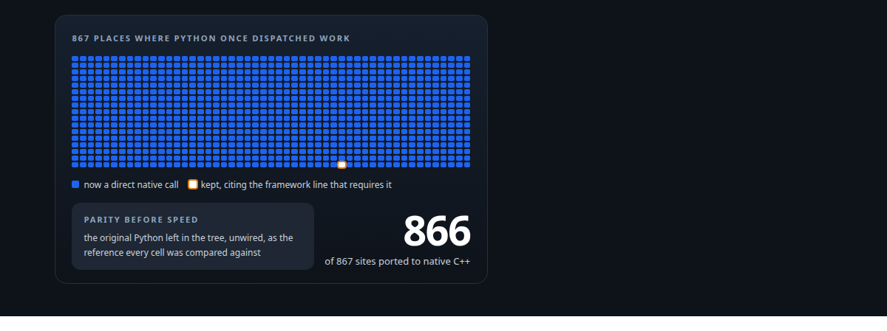
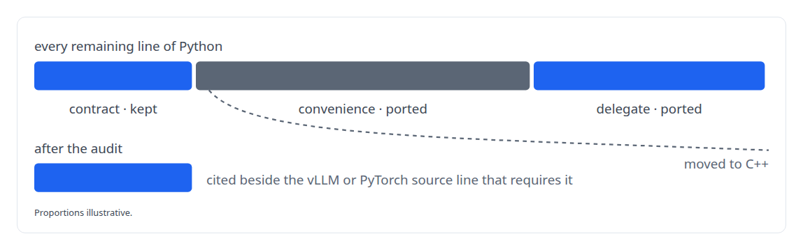
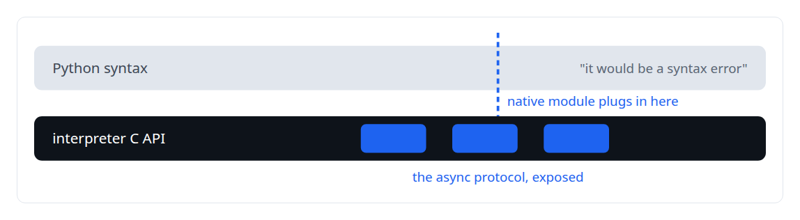
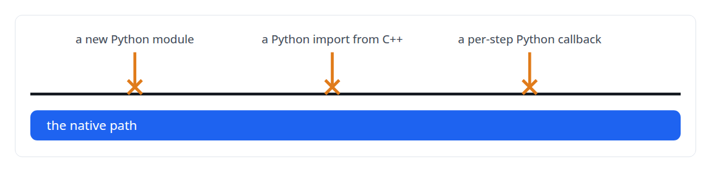

# Rewriting an engine extension without changing a token

**Porting a GPU serving layer from Python to native C++ with bit-identical output, and proving every remaining line of Python was required**

Canonical: https://coreyjames.ai/stories/rewriting-an-engine-extension-without-changing-a-token/  
Author: Corey James · Published: 2026-10-28 · Kind: story  
Systems: [ActiveKV](https://github.com/coreyjames-ai/activekv)  
Technologies: [C++](https://github.com/coreyjames-ai/portfolio/tree/main/technologies/c-plus-plus) · [Governed AI-assisted software engineering](https://github.com/coreyjames-ai/portfolio/tree/main/technologies/governed-ai-assisted-software-engineering) · [Intel Arc GPUs](https://github.com/coreyjames-ai/portfolio/tree/main/technologies/intel-arc-gpus) · [Intel oneAPI](https://github.com/coreyjames-ai/portfolio/tree/main/technologies/intel-oneapi) · [Large-scale refactoring with parity proof](https://github.com/coreyjames-ai/portfolio/tree/main/technologies/large-scale-refactoring-with-parity-proof) · [PyTorch](https://github.com/coreyjames-ai/portfolio/tree/main/technologies/pytorch) · [Python](https://github.com/coreyjames-ai/portfolio/tree/main/technologies/python) · [SYCL](https://github.com/coreyjames-ai/portfolio/tree/main/technologies/sycl) · [pybind11](https://github.com/coreyjames-ai/portfolio/tree/main/technologies/pybind11) · [vLLM](https://github.com/coreyjames-ai/portfolio/tree/main/technologies/vllm)  
Skills: [C++ and native ports with parity proof](https://github.com/coreyjames-ai/portfolio/tree/main/skills/c-and-native-ports-with-parity-proof) · [technical leadership of agent teams](https://github.com/coreyjames-ai/portfolio/tree/main/skills/technical-leadership-of-agent-teams) · [vLLM internals](https://github.com/coreyjames-ai/portfolio/tree/main/skills/vllm-internals) · [inference serving architecture](https://github.com/coreyjames-ai/portfolio/tree/main/skills/inference-serving-architecture)  



## Result

| Figure | What it measures |
| --- | --- |
| **13 of 13** | exact-mode parity cells bitwise; 12 of 12 hybrid |
| **0** | Python files in the release payload |
| **77,000** | lines of C++ in 361 engine files |

## What was built

ActiveKV began life as Python inside vLLM. That was the right way to find out whether the design worked and the wrong way to deliver it: the per-token path was slow, and the product logic sat in readable source. I moved the whole runtime to native C++ in under three weeks. In every parity cell the output was bit-identical, and a line-by-line audit cites the exact framework contract behind the one place Python still dispatches.

## The challenge

A port like this fails in two ways. It changes behaviour, which in an inference engine means a different token somewhere in a long generation that nobody notices until a customer does. Or it stops short, leaving a layer of Python glue that everyone agrees is temporary and nobody removes. I wanted bit-for-bit parity wherever the reference was itself deterministic, and a native implementation with nothing left in Python that could not point at the specific vLLM or PyTorch interface demanding it.

## Constraints

The layer lives inside vLLM's scheduler, worker and attention backend, and I could not change those. Batched reference output varies between runs, so parity had to be defined carefully. The target is an Intel Arc Pro GPU on Intel's XPU stack, where some vendor kernels were still maturing. And the port was executed by AI coding agents in several lanes at once, so the definition of done had to be precise enough that no lane could declare itself finished early.

## My approach

I wrote a seven-criterion definition of done before the first line was ported, and made correctness the only goal until it was met. Performance work was deferred; nothing could be measured while Python remained on the route. One criterion did most of the work: only explicitly justified vLLM or PyTorch interface requirements may remain in Python. I paired it with a standard that closed a common evasion.


The migration ran in module lanes with independent quality-assurance agents who had not written the code. The original Python stayed in the tree, unwired, as the parity reference.

## What I built

A C++ execution engine, bound to Python through pybind11 and PyTorch's ATen, that owns context geometry, key-value state, admission policy, host-device transfers, tiled attention orchestration and telemetry.

A native launcher that embeds the interpreter.

A census of every former dispatch site, each converted to a direct native call or justified.

A retention audit labelling every remaining Python line as contract, convenience or delegate, with the framework source line that makes a contract line necessary. Convenience and delegate lines were ported.



A parity harness that runs the reference twice and gates bitwise only where the reference agrees with itself.

## Difficult decisions

Refusing "it would be a syntax error." One module's Python was defended on the grounds that an asynchronous protocol method cannot be expressed outside Python's async syntax. True of the syntax, false of the interpreter: the CPython C API exposes the asynchronous protocol directly. A spike proved it and the module was ported. Remaining Python had to be proven necessary.



Holding scope. I cut an adjacent line of work from scope so that "done" meant one thing.

Deferring every optimisation. Several obvious speed-ups were visible during the port. All of them waited. A port that changes behaviour and speed at the same time cannot be proven for either.

## Results

The release is delivered as compiled binaries plus a patch to the user's own vLLM, and the boundary is checked on every change after it.



## Technologies used

C++ · pybind11 · PyTorch ATen · CPython C API · vLLM internals · SYCL and oneAPI · Intel Arc GPUs · Bitwise parity validation

## What this demonstrates

I can define "done" precisely enough that a large, parallel team of AI agents can reach it and prove it. I reason about language boundaries from the interpreter's actual contract. And I hold the line on correctness before speed even when the speed-ups are in plain view.

> A framework interface requiring a Python function does not mean the implementation inside that function must be Python.

## What was verified

Each line is a claim the canonical page supports, with the figure as the page states it.

- C++ and native ports with parity proof: a vLLM extension moved from Python to native C++ with 13 of 13 exact parity cells bitwise and 12 of 12 hybrid.
- vLLM internals: a runtime layer inside vLLM's scheduler, worker and attention backend ported without changing those interfaces, 77,000 lines of C++ in 361 engine files.
- Python and C++ interoperability: an async protocol the defence said needed Python, implemented natively through the interpreter's C API.
- Technical leadership of agent teams: a seven-criterion definition of done and independent QA agents per module lane, with 0 Python files in the release payload.
- Code review policy for native boundaries: an intake review that rejects new Python modules, Python imports from C++ and per-step Python callbacks on the native path.

## Related

- [Context beyond VRAM](https://github.com/coreyjames-ai/activekv/tree/main/stories/context-beyond-vram) · https://coreyjames.ai/stories/context-beyond-vram/
- [Proving a rewrite is the same system](https://github.com/coreyjames-ai/activekv/tree/main/stories/proving-a-rewrite-is-the-same-system) · https://coreyjames.ai/stories/proving-a-rewrite-is-the-same-system/
- [Directing AI coding agents at program scale](https://github.com/coreyjames-ai/agentos/tree/main/stories/directing-ai-coding-agents-at-program-scale) · https://coreyjames.ai/stories/directing-ai-coding-agents-at-program-scale/

## Citation

Corey James. "Rewriting an engine extension without changing a token." coreyjames.ai, 2026. https://coreyjames.ai/stories/rewriting-an-engine-extension-without-changing-a-token/

```bibtex
@misc{coreyjames-rewriting-an-engine-extension-without-changing-a-token,
  author = {Corey James},
  title = {Rewriting an engine extension without changing a token},
  year = {2026},
  howpublished = {\url{https://coreyjames.ai/stories/rewriting-an-engine-extension-without-changing-a-token/}},
  note = {GitHub copy: https://github.com/coreyjames-ai/activekv/tree/main/stories/rewriting-an-engine-extension-without-changing-a-token}
}
```

Part of [ActiveKV](https://github.com/coreyjames-ai/activekv) and [Corey James's portfolio](https://github.com/coreyjames-ai/portfolio) · site: https://coreyjames.ai/ · MCP server: https://coreyjames.ai/mcp · agent card: https://coreyjames.ai/.well-known/agent.json
