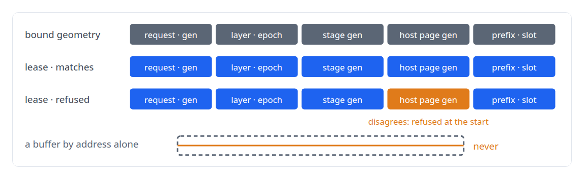
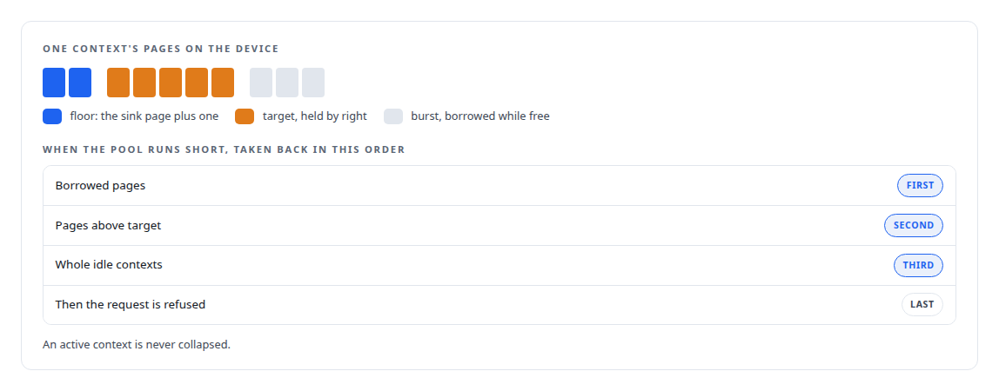
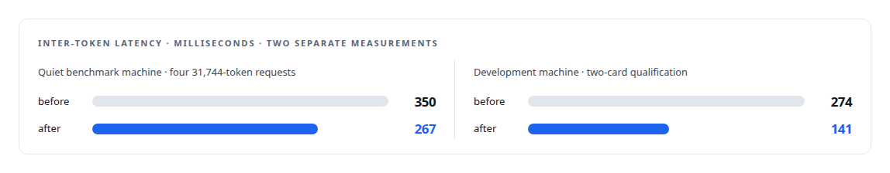

# Staging without a stall

**The fence-safe lifecycle and the admission arithmetic that let ActiveKV stream history across the bus without ever reading a stale buffer**

Canonical: https://coreyjames.ai/stories/staging-without-a-stall/  
Author: Corey James · Published: 2026-10-28 · Kind: story  
DOI: https://doi.org/10.5281/zenodo.23735116 (this page is a chapter of the system's report)  
Systems: [ActiveKV](https://github.com/coreyjames-ai/activekv)  
Technologies: [C++](https://github.com/coreyjames-ai/portfolio/tree/main/technologies/c-plus-plus) · [GPU memory management](https://github.com/coreyjames-ai/portfolio/tree/main/technologies/gpu-memory-management) · [Intel Arc GPUs](https://github.com/coreyjames-ai/portfolio/tree/main/technologies/intel-arc-gpus) · [KV-cache engineering](https://github.com/coreyjames-ai/portfolio/tree/main/technologies/kv-cache-engineering)  
Skills: [GPU inference optimisation](https://github.com/coreyjames-ai/portfolio/tree/main/skills/gpu-inference-optimisation) · [vLLM internals](https://github.com/coreyjames-ai/portfolio/tree/main/skills/vllm-internals) · [inference serving architecture](https://github.com/coreyjames-ai/portfolio/tree/main/skills/inference-serving-architecture) · [AI-assisted engineering methodology](https://github.com/coreyjames-ai/portfolio/tree/main/skills/ai-assisted-engineering-methodology)  


## Result

| Figure | What it measures |
| --- | --- |
| **12 of 12** | bitwise cells on both routes, staged against fully resident attention |
| **14.5** | tokens per second, up from 8.4, four 31,744-token requests |
| **33.2 GB** | device peak on the same run, up from 24.8: freed memory put to work |

## What was built

Each dense layer in ActiveKV needs its history on the device for one attention call. The copy in is asynchronous, the attention is asynchronous, and the new token's keys and values must flow back to the host copy. A staging buffer reused one event too early reads another layer's or another step's history, and the attention output looks plausible. Nothing crashes. I designed the staging lifecycle so that this class of bug cannot happen, and the admission arithmetic so that the card refuses what it cannot serve instead of degrading.

## Two copy queues and device-side ordering

The engine owns a dedicated host-to-device queue, a dedicated device-to-host queue, and the attention compute queue. Ordering between them is on the device: the compute queue waits on an event recorded after the history copy, and the write-back queue waits on an event recorded after attention. The host never blocks on the hot path to order work.

## Leases instead of buffers

Every staged layer is a transaction keyed by a lease.



A new lease may begin only if the previous one is sealed or retired, and if it is sealed but not retired, the new lease must list the previous stage's readers, its attention-consumed event and its tail write-back event, among its own prior readers. The next layer's copy therefore cannot overwrite a buffer the previous attention or write-back is still reading.

After attention the engine records a consumer event and copies back only the changed rows to the authoritative pinned host rows, refusing a different host owner from the one the lease began with. A stage is sealed only with its current tail and the same attention event recorded earlier; a substituted event is an error. Retirement performs throwing waits on every consumer event and every copy ticket, produces receipts, and only then removes the tickets and the layer. Copy tickets hold the pinned tensor owner and a host page lease, so a host page cannot recycle its generation while direct memory access still reads it.

Any failure marks the transport failed. Quarantine synchronises both copy queues, every materialisation queue and then the device, and if any of those cannot establish completion, every owner, buffer and lease stays retained. The destructor never waits, submits or drains.


Whole-layer staging was kept only when staged attention produced bit-identical logits against fully resident attention, and the release reproduces that on both routes.

## Admission that does arithmetic

The device page pool is an explicit whole-number of gibibytes, never automatic, because an automatic size hides the operator's choice. One device allocation serves all sixteen dense layers. Each context has a target it may hold by right, an optional burst it may borrow while pages are free, and a floor of the sink page plus one. Each step the engine computes the newest pages a context needs, keeps the sink, and fills in order: reuse one of the context's own pages outside the window, take a free page, reclaim within the target, or shrink from the oldest page while keeping the tail hot. Reclamation runs least-recently-active first.



Nothing is collapsed except at a step boundary. Every reclamation is ordered and counted, so an admission wait can be explained afterwards.

The host pool fit is printed with its formula at startup: the effective concurrency is the smaller of the configured limit and the number of sixteen-segment histories the pinned pool can hold. In refuse mode a geometry that does not fit stops at startup and names the setting to change. In shrink mode the engine lowers concurrency to what fits, logs the formula, and lets the serving layer queue the rest.

## Spending what the staging freed

With history on the host, device memory is free, and two promoted mechanisms spend part of it on decode speed: an owner's immutable history retained in its admitted arena and materialised with a device-to-device copy overlapped with the suffix copy, and history retained in revocable headroom the engine profiled as free and can take back under admission pressure. They were measured twice, on different machines and setups, and the two series stand apart.



## What this demonstrates

Lifecycle design for asynchronous accelerator work where the failure mode is silent, and resource control that prefers an explicit refusal to a degraded answer. The invariants are stated in the engine's own source: source authority survives until its replacement is valid, logical cancellation revokes publication but physical reuse waits for every fence, and partial submissions quarantine until a drain proves completion.

> Nothing is recycled on an uncertain fence.

## What was verified

Each line is a claim the canonical page supports, with the figure as the page states it.

- Asynchronous GPU memory management: a fence-safe staging lifecycle keyed by leases, in which nothing is recycled on an uncertain fence.
- Numerical reproducibility and bitwise validation: whole-layer staging accepted only on bit-identical logits against fully resident attention, 12 of 12 on both routes.
- GPU memory admission control: explicit page pools with targets, bursts and least-recently-active reclamation that refuses a request rather than degrading it.
- Latency engineering under concurrency: four 31,744-token requests on the quiet benchmark machine went from 350 to 267 ms inter-token latency and 8.4 to 14.5 tokens per second.
- GPU memory reuse: device peak raised from 24.8 to 33.2 GB to spend memory freed by host-resident history on decode speed.

## Related

- [Context beyond VRAM](https://github.com/coreyjames-ai/activekv/tree/main/stories/context-beyond-vram) · https://coreyjames.ai/stories/context-beyond-vram/
- [Half the bytes, exactly merged](https://github.com/coreyjames-ai/activekv/tree/main/stories/half-the-bytes-exactly-merged) · https://coreyjames.ai/stories/half-the-bytes-exactly-merged/
- [The observer that changed the answer](https://github.com/coreyjames-ai/activekv/tree/main/stories/the-observer-that-changed-the-answer) · https://coreyjames.ai/stories/the-observer-that-changed-the-answer/

## Citation

Corey James. "Staging without a stall." coreyjames.ai, 2026. https://coreyjames.ai/stories/staging-without-a-stall/ In: the ActiveKV technical report, doi:10.5281/zenodo.23735116.

```bibtex
@misc{coreyjames-staging-without-a-stall,
  author = {Corey James},
  title = {Staging without a stall},
  year = {2026},
  howpublished = {\url{https://coreyjames.ai/stories/staging-without-a-stall/}},
  note = {GitHub copy: https://github.com/coreyjames-ai/activekv/tree/main/stories/staging-without-a-stall},
  doi = {10.5281/zenodo.23735116}
}
```

Part of [ActiveKV](https://github.com/coreyjames-ai/activekv) and [Corey James's portfolio](https://github.com/coreyjames-ai/portfolio) · site: https://coreyjames.ai/ · MCP server: https://coreyjames.ai/mcp · agent card: https://coreyjames.ai/.well-known/agent.json
