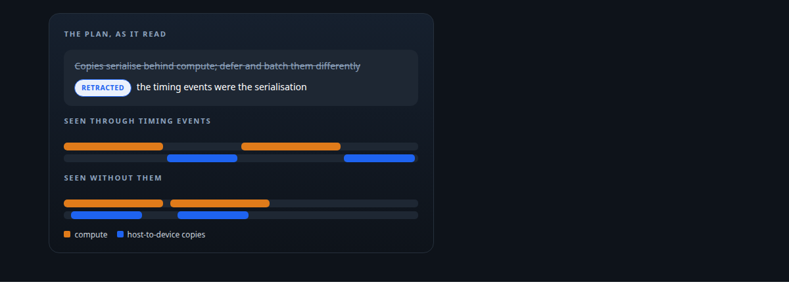
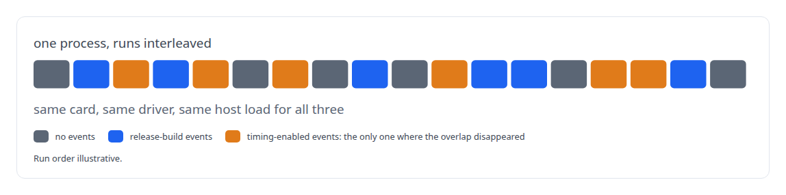
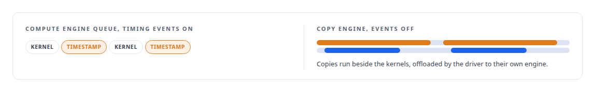

# The observer that changed the answer

**Discovering that my own profiler caused the serialisation it reported, and retracting a verdict I had already acted on**

Canonical: https://coreyjames.ai/stories/the-observer-that-changed-the-answer/  
Author: Corey James · Published: 2026-10-28 · Kind: story  
DOI: https://doi.org/10.5281/zenodo.23735116 (this page is a chapter of the system's report)  
Systems: [ActiveKV](https://github.com/coreyjames-ai/activekv)  
Technologies: [GPU profiling and tracing](https://github.com/coreyjames-ai/portfolio/tree/main/technologies/gpu-profiling-and-tracing) · [Intel Arc GPUs](https://github.com/coreyjames-ai/portfolio/tree/main/technologies/intel-arc-gpus) · [Intel oneAPI](https://github.com/coreyjames-ai/portfolio/tree/main/technologies/intel-oneapi) · [LD_PRELOAD symbol interposition](https://github.com/coreyjames-ai/portfolio/tree/main/technologies/ld-preload-symbol-interposition) · [Performance engineering and benchmarking](https://github.com/coreyjames-ai/portfolio/tree/main/technologies/performance-engineering-and-benchmarking) · [PyTorch](https://github.com/coreyjames-ai/portfolio/tree/main/technologies/pytorch)  
Skills: [Intel GPU and SYCL/oneAPI engineering](https://github.com/coreyjames-ai/portfolio/tree/main/skills/intel-gpu-and-sycl-oneapi-engineering) · [evidence-gated acceptance](https://github.com/coreyjames-ai/portfolio/tree/main/skills/evidence-gated-acceptance)  



## Result

| Figure | What it measures |
| --- | --- |
| **≤ 0.21** | copy and compute overlap with timing-enabled events on, from 0.02 |
| **≥ 0.79** | overlap with no events, or with release-build events only, up to 1.09 |
| **3** | variants interleaved in one process to test the instrument |

## What was built

A trace from my instrumented runtime showed that host-to-device copies were not overlapping with compute on the Intel card. I believed it, and I made a design decision on it. Then a controlled experiment showed that the timing events I had enabled to see the overlap were themselves the reason there was none. I retracted the verdict in the plan, and every overlap claim since gets an uninstrumented variant before anyone acts on it.

## The challenge

Whether copies and compute overlap on a GPU decides the whole economics of a memory layer that stages data across the bus every step. You cannot see overlap without instrumentation, and instrumentation touches the thing it measures. The trace said the copy engine was serialising behind compute, and a design response, deferring and batching copies differently, was already in motion.

## Constraints

Instrumentation is unavoidable: there is no way to see the timeline without events on it. And a decision had already been made, so the cost of being wrong was work in flight on a false premise.

## My approach

Run the same workload in one process, interleaving three variants. If the overlap differs across variants, the profiler is part of the result.




## What I built

A confound experiment showing that timing-enabled events were lowered into timestamp commands on the compute engine, and that those commands forced the driver-offloaded copy engine to wait. With them off, the copies overlapped.



A retraction in the plan, naming the earlier verdict, the evidence that overturned it, and the work that had been started on it.

A standing rule that every claim about overlap or serialisation gets an uninstrumented control before it is acted on, and that instrumented runs are never quoted as product speed.

## Difficult decisions

Retracting publicly. The verdict was mine and acted on. The cheap path was to quietly correct course. I wrote the retraction into the plan so anyone reading the plan later would see the wrong turn and why it happened.

## Results

On one Intel Arc Pro GPU, the design response built on the false reading was withdrawn once the variants were in.

## Technologies used

PyTorch XPU events · Level Zero runtime · Intel GPU copy engines · Controlled instrumentation experiments · Intel Arc GPUs

## What this demonstrates

Knowledge of the GPU runtime below the framework, and the habit of checking that the instrument is not the result. When I am wrong in writing I correct it in writing.

> Measure the measurement.

## What was verified

Each line is a claim the canonical page supports, with the figure as the page states it.

- GPU profiling and instrumentation: showed timing-enabled events serialised host-to-device copies behind compute, overlap 0.02-0.21 with them against 0.79-1.09 without.
- Performance experiment design: 3 instrumentation variants interleaved in one process, so the card, the driver and the host load were identical for all of them.
- Intel GPU and SYCL/oneAPI engineering: traced timing events to timestamp commands on the compute engine that made the copy engine wait, on the Level Zero runtime.
- Scientific integrity in engineering: a written retraction of my own verdict in the plan, and a standing rule that every overlap claim gets an uninstrumented control.

## Related

- [Proving a rewrite is the same system](https://github.com/coreyjames-ai/activekv/tree/main/stories/proving-a-rewrite-is-the-same-system) · https://coreyjames.ai/stories/proving-a-rewrite-is-the-same-system/
- [Context beyond VRAM](https://github.com/coreyjames-ai/activekv/tree/main/stories/context-beyond-vram) · https://coreyjames.ai/stories/context-beyond-vram/

## Citation

Corey James. "The observer that changed the answer." coreyjames.ai, 2026. https://coreyjames.ai/stories/the-observer-that-changed-the-answer/ In: the ActiveKV technical report, doi:10.5281/zenodo.23735116.

```bibtex
@misc{coreyjames-the-observer-that-changed-the-answer,
  author = {Corey James},
  title = {The observer that changed the answer},
  year = {2026},
  howpublished = {\url{https://coreyjames.ai/stories/the-observer-that-changed-the-answer/}},
  note = {GitHub copy: https://github.com/coreyjames-ai/activekv/tree/main/stories/the-observer-that-changed-the-answer},
  doi = {10.5281/zenodo.23735116}
}
```

Part of [ActiveKV](https://github.com/coreyjames-ai/activekv) and [Corey James's portfolio](https://github.com/coreyjames-ai/portfolio) · site: https://coreyjames.ai/ · MCP server: https://coreyjames.ai/mcp · agent card: https://coreyjames.ai/.well-known/agent.json
